# Help Desk Ticketing Lab: osTicket on Ubuntu Server + Active Directory

A hands-on IT support lab where I deployed **osTicket** on an **Ubuntu Server** VM, configured it like a real help desk, and worked six simulated tickets against my **Active Directory** domain from intake to resolution. I also wrote knowledge base articles based on those tickets.

This project builds on my earlier lab: [Active Directory Lab: Windows Client Management & Group Policy](https://github.com/IshuaB-sudo/ad-lab-windows-client-gpo).

> **Note:** All tickets are simulated. I created each problem on purpose, then troubleshot and fixed it as the help desk technician would, and documented everything in osTicket.

---

## What this project demonstrates

- Deploying and securing a Linux web application server (Ubuntu, Apache, MariaDB, PHP)
- Configuring a ticketing system: departments, help topics, SLA plans, roles, and agents
- Least privilege and separation of privileged accounts (RBAC)
- Troubleshooting Active Directory accounts, groups, Group Policy, and DNS
- Documenting tickets from intake to resolution (symptom, cause, fix, verification)
- Writing knowledge base articles for both end users and technicians

---

## Lab environment

| Machine | Role | OS | IP |
|---|---|---|---|
| DC01 | Domain controller, DNS | Windows Server 2022 | 192.168.51.10 |
| CLIENT01 | Domain-joined workstation | Windows 11 Enterprise (eval) | DHCP |
| **OSTICKET01** | **Help desk server (new)** | **Ubuntu Server 24.04.5 LTS** | **192.168.51.20** |

- **Hypervisor:** VMware Workstation Pro on a Windows 11 laptop
- **Network:** VMware NAT (192.168.51.0/24)
- **Domain:** iamlab.internal
- **Help desk URL:** `http://osticket01.iamlab.internal` (DNS A record on DC01)

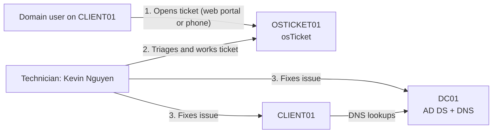

---

## Phase 1: Building the Ubuntu Server VM

- Downloaded the Ubuntu Server 24.04.5 ISO and **verified its SHA-256 checksum** against Ubuntu's published `SHA256SUMS` file before using it.
- Created the VM in VMware: 2 vCPUs, 2 GB RAM, 25 GB disk, NAT network. Removed the sound card and printer, which a server doesn't need.
- Set a **static IP** (192.168.51.20) with DC01 as the DNS server, so the server can resolve domain names.
- Configured **LVM** so the root volume uses the full disk (the installer's default leaves about half unallocated).
- Created a non-default admin username instead of `admin` or `ubuntu`.
- Installed and enabled **OpenSSH** for remote administration, applied all available updates, and set the time zone to America/New_York (important for accurate SLA due dates and logs).

| ISO checksum verified | First login |
|---|---|
| 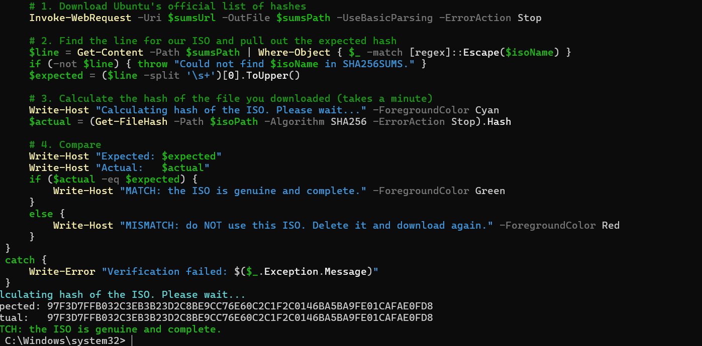 | 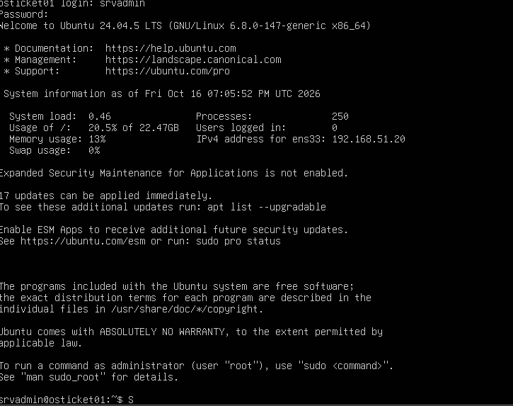 |

---

## Phase 2: Installing osTicket securely

Before installing, I checked osTicket's official requirements. osTicket **v1.18.4** requires PHP 8.2 to 8.4, and Ubuntu 24.04 ships **PHP 8.3**, so no third-party PHP repositories were needed.

**Stack:** Apache 2.4.58, MariaDB 10.11.14, PHP 8.3.6, osTicket v1.18.4

Security steps:
- Ran `mariadb-secure-installation` to remove anonymous users and the test database, and to block remote root logins.
- Created a **dedicated database user** for osTicket with privileges on the `osticket` database only, and only from `localhost`.
- Downloaded osTicket from the **official GitHub release over HTTPS**. (osTicket doesn't publish a checksum file, so the official HTTPS source is the integrity check.)
- Kept the website files owned by `root` so Apache can read them but not change them.
- After installation, **locked the config file** (`root:www-data`, mode `0640`), which is stricter than osTicket's suggested `0644`, since the file contains the database password. **Deleted the `setup/` folder.**
- Apache site config disables directory listings (`Options -Indexes`).
- Added a DNS A record on DC01 so users reach the help desk by name.

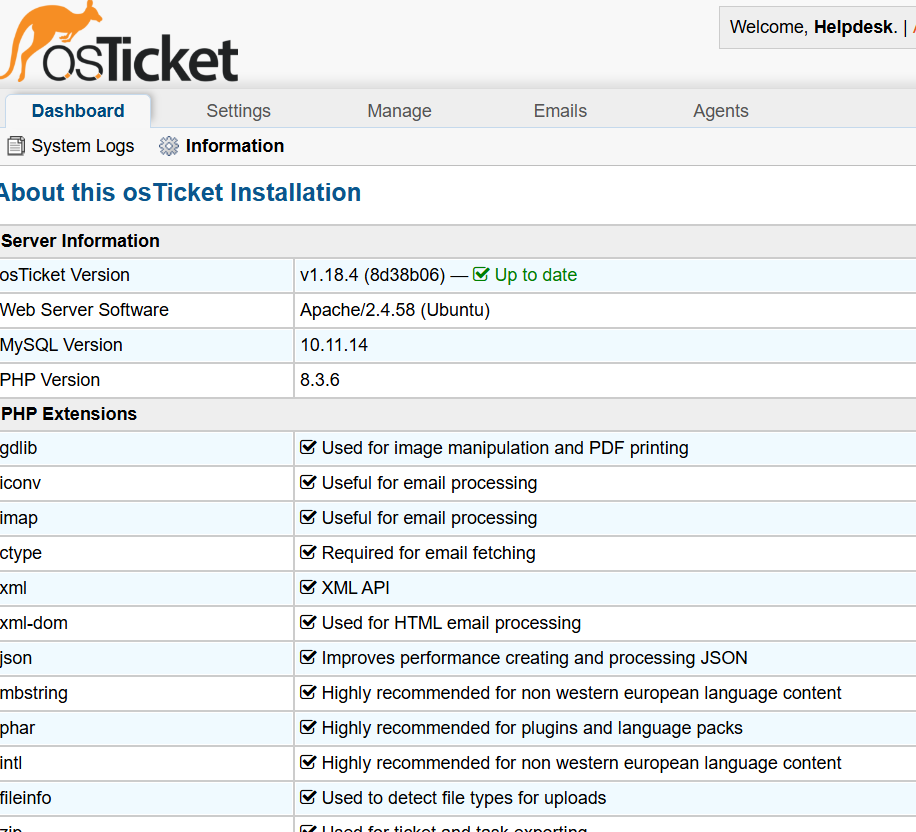

---

## Phase 3: Configuring the help desk

### Departments
**IT** (default), **HR**, **Finance**, and **Sales**. In osTicket, a department is the team that *works* a ticket, so all six tickets below went to IT.

### SLA plans

| SLA plan | Grace period | Used for |
|---|---|---|
| High Priority - 4 Hours | 4 business hours | User can't work at all |
| Standard - 24 Hours (default) | 24 business hours | Broken, but with a workaround |
| Low - 72 Hours | 72 business hours | Requests |

SLAs count **business hours**. I verified this: a ticket opened Friday at 6:11 PM was correctly due Monday at 12:00 PM.

### Help topics
Each topic automatically routes the ticket to a department and sets its priority and SLA, so tickets are sorted the moment they arrive.

| Help topic | Department | Priority | SLA |
|---|---|---|---|
| Account Access - Lockout / Password Reset | IT | High | 4 hours |
| Network / Domain Connectivity | IT | High | 4 hours |
| Mapped Drive / File Share Access | IT | Normal | 24 hours |
| Group Policy / Workstation Settings | IT | Normal | 24 hours |
| Software Installation Request | IT | Low | 72 hours |
| HR Request / Finance Request / Sales Request | HR / Finance / Sales | Normal | 24 hours |
| General Inquiry | IT | Normal | 24 hours |

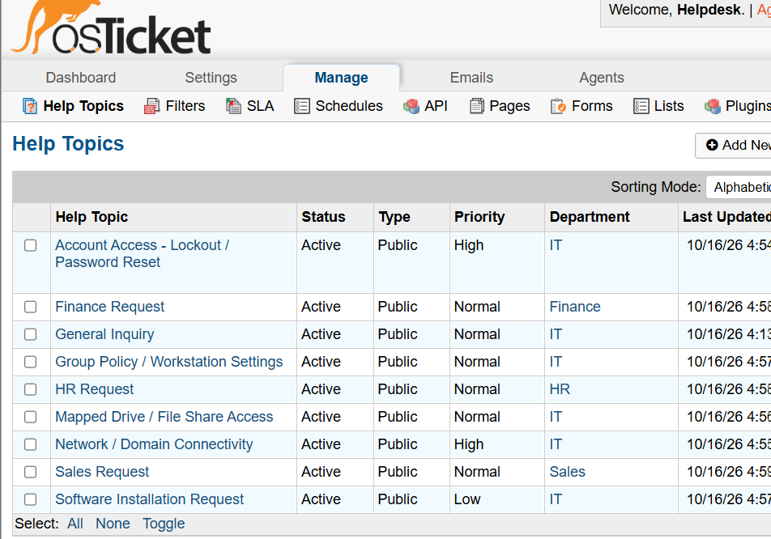

### Roles and agents (least privilege)
- **Separate admin account:** `ostadmin` is used only for configuration. The technician account is not an administrator.
- **Technician account:** Kevin Nguyen (`knguyen`) matches his AD username. It's a separate local osTicket account (not connected to AD), and it required a password change at first login.
- **Help Desk Technician role:** Kevin can create, assign, transfer, reply to, and close tickets, but **cannot delete tickets** (protects the audit trail) or **edit other agents' thread entries** (keeps records trustworthy).
- **Agent-level permissions:** he can see all departments (to transfer misrouted tickets), but **"see all tickets in search"** is off, because it would bypass department restrictions.
- Verified by logging in as Kevin: no Admin Panel link.

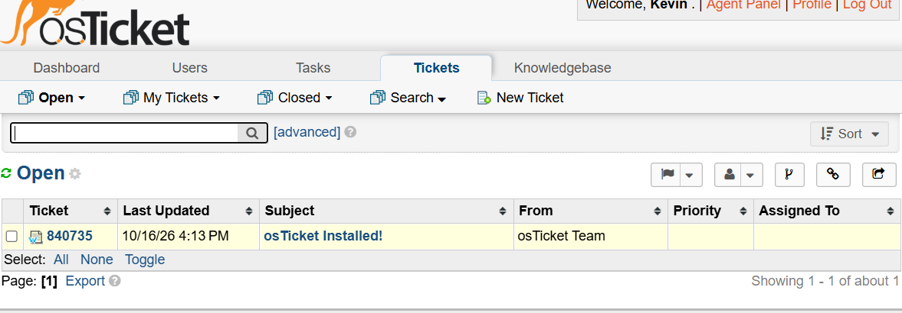

---

## Phase 4: Working the tickets

| # | Ticket | Intake | Key skill |
|---|---|---|---|
| 1 | Forgotten password | Phone | Identity verification, secure reset with forced change |
| 2 | Account lockout | Phone | **Found and fixed a missing lockout policy**; lockout source via Event ID 4740 |
| 3 | Shared drive access denied | Web portal | Group-based access, authorization check, triage |
| 4 | Software install request | Web portal | Least privilege, local admin vs. domain admin |
| 5 | Group Policy not applying | Phone | OU scope, `gpresult`, GPO precedence |
| 6 | Can't reach internal resources | Phone | Layered network troubleshooting, DNS |

Every ticket was closed with an internal note in the same format: **Symptom, Cause, Fix, Verification.**

### Ticket 1: Forgotten password (James Carter, Finance)
- **Intake:** phone call. Kevin created the ticket, which was auto-assigned High priority and a 4-hour SLA.
- **Identity verification (simulated):** documented a callback to the number on file before making any change. "Reset my password" calls are a common social engineering attack.
- **Investigation:** confirmed the account was enabled and not locked before changing anything.
- **Fix:** reset the password on DC01 with `Set-ADAccountPassword`, entering the temporary password through `Read-Host -AsSecureString` so it never appeared on screen or in history, and set "change password at next logon."
- **Verification:** the user signed in, was forced to set a new password, and could open the Finance drive (F:). Closed within SLA.

| Password reset | Forced change at sign-in |
|---|---|
| 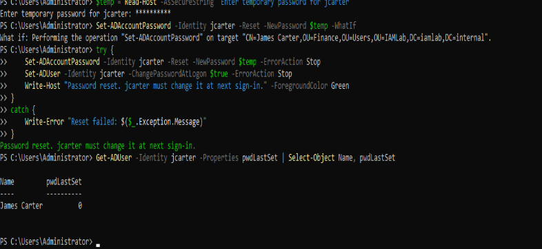 | 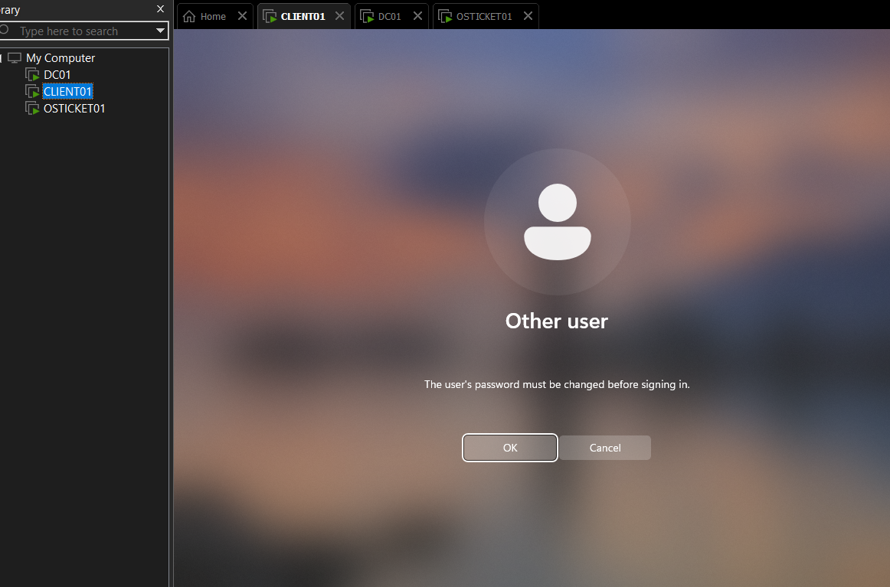 |

### Ticket 2: Account lockout (Sophie Martin, Finance)
- **Security finding:** while preparing this ticket, I found the domain had **no account lockout policy** (threshold 0). Twelve failed sign-ins in a row didn't lock the account, so an attacker could guess passwords indefinitely.
- **Fix to the domain:** configured lockout in the **Default Domain Policy** GPO: 5 attempts, 15-minute lockout, 15-minute reset window. Verified with `Get-ADDefaultDomainPasswordPolicy`.
- **Investigation:** confirmed the lockout in AD, then used **Event ID 4740** on DC01 to find the source. *Caller Computer Name* showed **CLIENT01**, the user's own workstation, so there was no sign of someone else guessing her password.
- **Fix:** the user didn't know her password, so I **unlocked the account and reset the password**. A reset alone doesn't unlock an AD account, so both steps were needed.
- **Verification:** the user signed in and could open F:.

| Lockout policy (5 / 15 / 15) | Event ID 4740: lockout source |
|---|---|
| 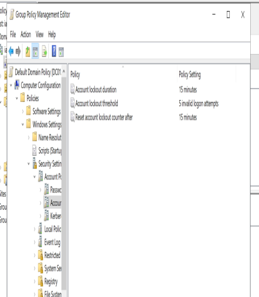 | 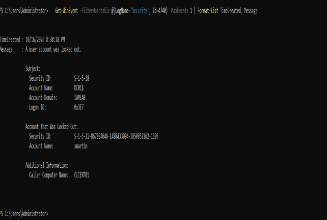 |

### Ticket 3: Shared drive access denied (Maria Lopez, HR)
- **Symptom:** the H: drive appeared, but opening it returned *"You do not have permission to access \\\\DC01\\HR"*.
- **Intake:** submitted by the user through the web portal. It arrived unassigned, and Kevin **triaged** it (checked routing and priority, then assigned it to himself).
- **Cause (simulated):** she had been removed from **GRP-HR-Users**, the group that grants access to the HR share.
- **Authorization check:** confirmed her role matches the group (Department: HR, OU=HR) before restoring access. In production, this would also be confirmed with her manager or an approved request.
- **Fix:** re-added her with `Add-ADGroupMember`, then had her sign out and back in so her new sign-in picked up the change.
- **Verification:** AD showed her as a member, and H: opened without the error.
- **Open question:** `whoami /groups` and `gpresult` didn't list GRP-HR-Users in her session, even though access worked after the fix. I documented this as unexplained rather than guessing.

| User's error | Root cause found |
|---|---|
| 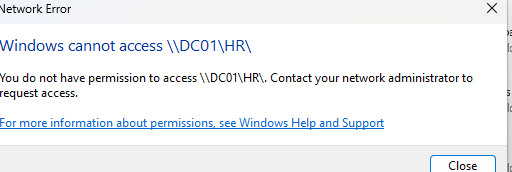 | 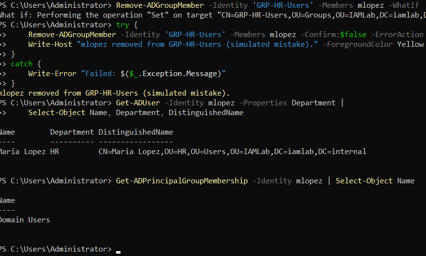 |

### Ticket 4: Software install request (James Carter, Finance)
- **Symptom:** the user tried to install 7-Zip himself and was stopped by a UAC administrator prompt. That's least privilege working as intended.
- **Approval check (simulated):** confirmed 7-Zip is approved and free for business use.
- **Fix:** installed it silently (`/S`) from an elevated PowerShell window using CLIENT01's **local admin account**, while the user stayed signed in. **Domain admin credentials were not used on the workstation.**
- **Security note:** `Get-AuthenticodeSignature` showed the installer was **not digitally signed**, so the official HTTPS download was the only source check. In a company, I'd use an approved software catalog or compare against a known hash.
- **Verification:** the program files were present, and the user opened 7-Zip from the Start menu.

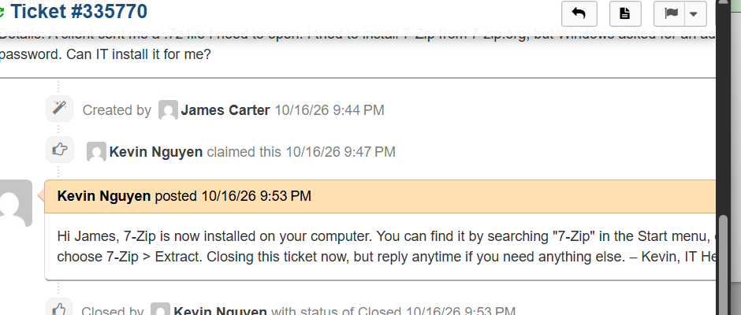

### Ticket 5: Group Policy not applying (CLIENT01)
- **Symptom:** the "Authorized Use Only" sign-in banner no longer appeared.
- **Investigation:** `gpresult /r /scope computer` showed only Default Domain Policy applied; **Workstation Security was missing**.
- **Cause (simulated):** CLIENT01's computer account was in the default `CN=Computers` container instead of the `IAMLab\Computers` OU where the GPO is linked.
- **Fix:** moved it back with `Move-ADObject`, ran `gpupdate /force`, and restarted.
- **Lesson learned (real mistake):** my first update to the banner text went into the **Default Domain Policy** by mistake and had no effect, because the OU-linked GPO takes precedence. I removed the stray setting and made the change in the correct GPO.
- **Verification:** `gpresult` listed Workstation Security, and the updated banner appeared at sign-in.

| Before: Workstation Security missing | After: applied |
|---|---|
| 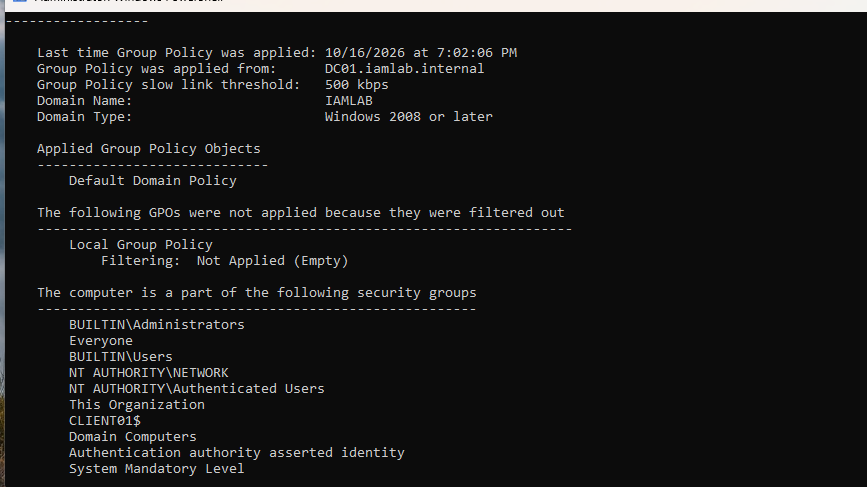 | 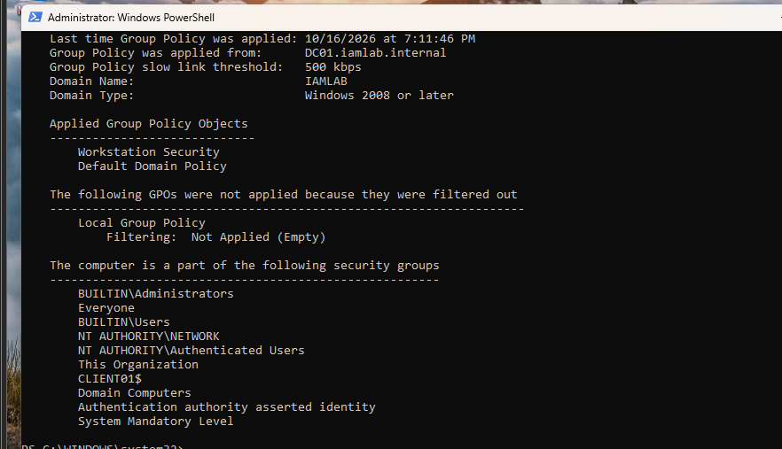 |

### Ticket 6: Can't reach internal resources (CLIENT01)
- **Symptom:** internet sites worked, but the F: drive and help desk site didn't. That's the classic sign of a DNS problem.
- **Cause (simulated):** CLIENT01's DNS server was set to the VMware router (192.168.51.2) instead of DC01.
- **Investigation, one layer at a time:**
  1. DNS server setting: 192.168.51.2 (wrong for a domain computer)
  2. Ping DC01 by IP: **worked**, so the network path is fine
  3. Resolve `dc01.iamlab.internal`: **"DNS name does not exist"**
  4. Same lookup directly against DC01: **worked**, which confirmed the PC was asking the wrong server
- **Fix:** set DNS back to 192.168.51.10, cleared the cache, and re-registered.
- **Verification:** both names resolved, `Test-ComputerSecureChannel` returned `True`, and the user could open F: and the help desk site.

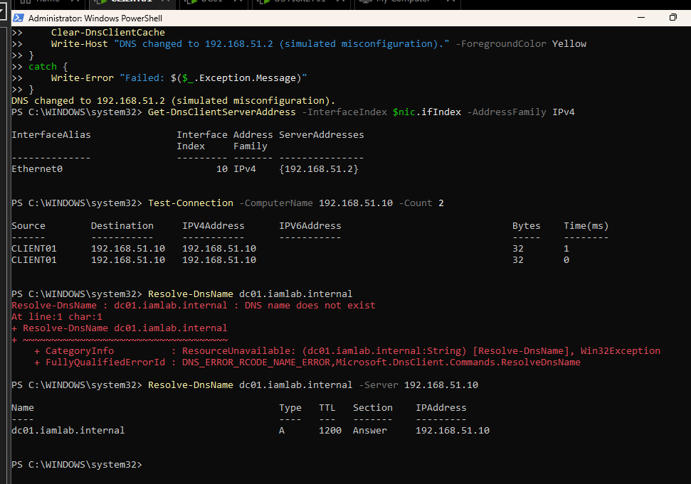

---

## Phase 5: Knowledge base

I wrote four articles: two for **users** (public, self-service) and two for **technicians** (internal only).

| Article | Audience |
|---|---|
| Locked out or forgot your password? | Users |
| Can't open your H: or F: drive? | Users |
| Account lockout: how to find the source and fix it | Technicians |
| Domain PC can't reach internal resources but internet works (DNS checklist) | Technicians |

I verified from CLIENT01 as a guest that the portal shows only the two user articles. A detail I learned: osTicket only shows an article publicly when **both** its category and the article itself are set to public.

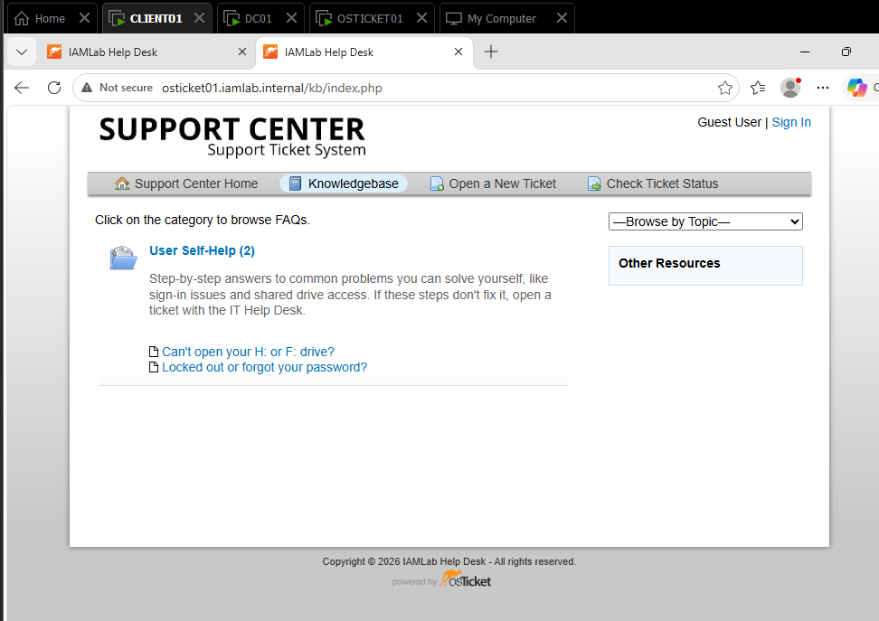

---

## Problems I ran into (and how I solved them)

| Problem | Cause | Solution |
|---|---|---|
| Web installer showed a generic error page | Database password in the form didn't match | Read the Apache error log (`Access denied for user 'osticket'@'localhost'`), tested the login with the `mariadb` CLI, and re-entered it |
| SSH said "Connection refused" | OpenSSH wasn't installed | Recognized that "refused" (vs. "timed out") meant the host was reachable, then installed `openssh-server` |
| Multi-line commands did nothing when pasted | Line continuations broke during paste | Used single-line commands |
| osTicket said "unable to lock ticket" | My admin session had the ticket open (collision avoidance) | Closed the other session and waited for the lock to expire |
| Banner change had no effect | Edited the wrong GPO | Learned GPO precedence; fixed in the OU-linked GPO |
| Knowledge base hidden from users | Articles were still set to Internal | Set both category and articles to Public |
| Lost the Ubuntu admin password | Not saved | Recovered with GRUB recovery mode and `passwd`, which also showed why console access must be protected |

---

## Security considerations

- Verified the OS installer's integrity before use
- Dedicated, least-privilege database account; locked-down config file; installer removed
- Separate admin and technician accounts in osTicket; destructive permissions removed from the technician role
- Identity verification before credential changes; temporary passwords never written in tickets
- Domain admin credentials kept off the workstation; local admin used for installs
- Found and fixed a missing account lockout policy

## Future improvements

- **HTTPS** for osTicket (logins currently travel over HTTP inside the private lab network)
- Firewall (`ufw`) allowing only SSH and HTTP/HTTPS
- SSH key authentication with password logins disabled
- Connect osTicket agent logins to Active Directory (LDAP)
- Email (SMTP) for ticket notifications
- Scheduled database and file backups

---

## Skills used

`Ubuntu Server` `Apache` `MariaDB` `PHP` `osTicket` `Active Directory` `Group Policy` `DNS` `PowerShell` `Bash` `VMware Workstation` `RBAC` `Least privilege` `Troubleshooting` `Technical documentation`

## All screenshots

Every screenshot is in the [`screenshots/`](screenshots/) folder, numbered in the order the project was built.
